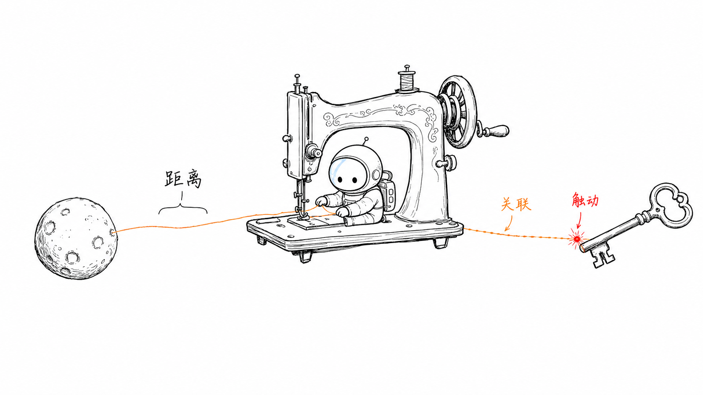
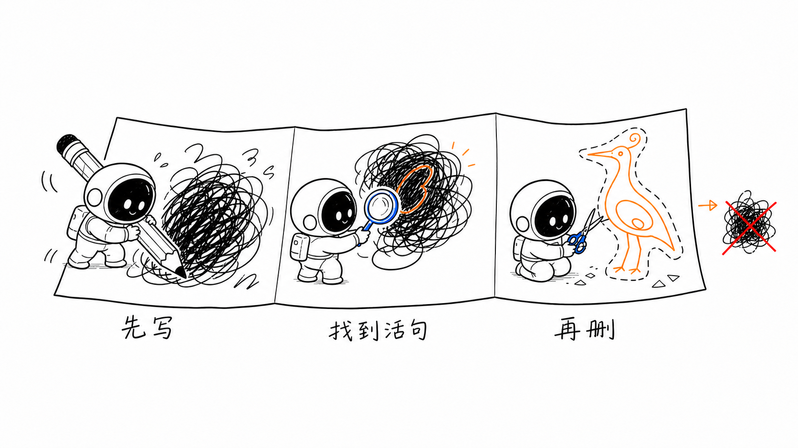
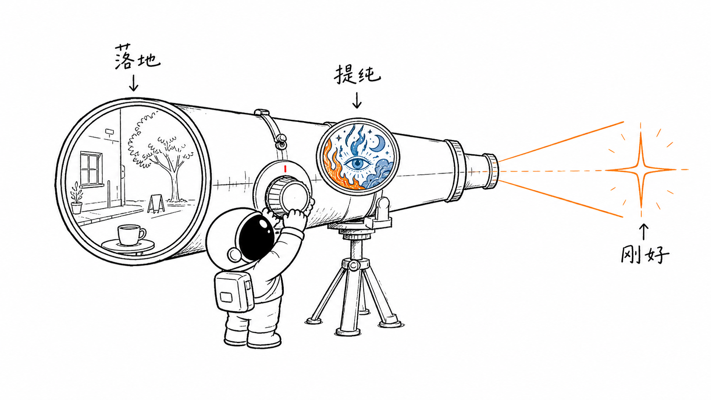

# 《意象的帝国》写诗方法论：以“错配”为核心的可执行提炼

> 说明：以下页码均指 PDF 文件页码，不是纸书印刷页码。报告区分“书中明确提出的观点”和“为生成器所做的工程化归纳”。

## 一、全书的核心结论

黄梵的写诗课可以压缩成一句话：

**从现实中取一个可感的场景，把其中熟悉的事物与一个低相关事物并置，制造陌生感；再用两者之间的一点真实关联，使陌生感变得准确；最后用客观意象、重复、象征、隐喻或结构，把局部诗意组织成整首诗。**

这套方法不是“随机拼词”。它有两个相反而同时成立的要求：

1. A 与 B 要相距足够远，否则只是日常搭配，没有新鲜感。
2. A 与 B 又必须存在一点可感的关联，否则只是语言游戏，容易晦涩、空洞。

可以把理想的诗意写成一个简化公式：

`诗意强度 ≈ 语义距离 × 可感关联 × 情感真实性`

- 语义距离负责“陌生”。
- 可感关联负责“准确”。
- 情感真实性负责“触动”。

**例子。**“雨是城市忘在窗外的一串钥匙”有距离，因为雨和钥匙不属同一领域；也有可感关联，因为两者都能发出连续、细碎的敲击声，且都悬在门窗之外。若只写“雨是悲伤”，则距离不足，也没有可见的场景。



书中先在第二堂课训练距离，允许学习者把错配当作语言游戏；第三堂课再补上关联、语境和真实体悟。这是全书最重要、也最容易被只摘录四个公式的人遗漏的一步。（PDF 第76–119页）

## 二、全书方法论的三层结构

### 1. 写作过程：先生成，再判断，再修改

书中反对把写作理解为依照完整腹稿组装成品。真实写作更接近试错和进化：理性提供一个方向，即兴与潜意识生成材料，修改让初稿逐步成形。（PDF 第17–26页）

可执行流程是：

1. 给自己一个有限目标、场景或结尾。
2. 快速写出允许粗糙和错误的初稿。
3. 从偶然生成的句子中找出真正有活力的部分。
4. 围绕它重写、删减、调整结构。
5. 搁置到作品在自己眼里变得陌生，再做严格修改。

**例子。**初稿可能只是“深夜加班，我看见窗外下雨”。改写时发现“电脑风扇一直响”更有活力，于是围绕它重写成“电脑风扇替整栋楼／练习一场没有观众的雨”。前句提供事实，后句才是值得保留的发现。



对诗歌生成器而言，这意味着不应一次从输入直接得到终稿，而应在内部经过“候选生成—筛选—桥接—成诗—删改”五步。

### 2. 诗句发动机：客观意象与主观意象

书中把意象分成两类：（PDF 第53–101页）

- **客观意象**：现实中存在或可能存在的场景。它负责地面、背景、叙事、可理解性。
- **主观意象**：现实中不能直接看见，只能借助想象成立的场景。它负责诗意浓度、陌生感和多义性。

两者不是优劣关系，而是浓度关系。书中的比喻是：客观意象像清汤，主观意象像味精。只有客观意象，诗容易平淡；只有主观意象，诗容易过浓、晦涩。

书中给出的实用尺度是“最小诗意单元”：一个相对完整的诗意，最好在四行以内形成；如果连续四行仍只有平淡的客观描写，就应加入一个主观意象提升浓度。（PDF 第119–129页）

**例子。**“末班车停在站台／广告灯还亮着／一个人把围巾塞进衣领”都是客观意象。补上“车门把夜色咬成两半”，场景立刻有了主观意象的压力，但读者仍知道人、车站和夜晚在哪里。



### 3. 整首诗：用一个组织原则把局部黏合起来

书中提出的主要整体方法有：（PDF 第147–185页）

- **重复/叠句**：用重复的整句、句式或关键词同时产生音乐性与结构。
- **节奏**：利用音节、重音、停顿和呼吸速度匹配情绪。
- **象征**：选择一个具体对应物，通篇描绘它，不直说它代表的抽象情感或观念。
- **整体隐喻**：让 A 与 B 两个事物在全诗中持续对照、互相解释。
- **通感**：用一种感官经验描述另一种感官经验。
- **三段式 `A–B–A′`**：A 建立主题，B 对比、翻转或深化，A′ 回到 A 但有所变化和提升。

全书对整体写作最实用的警告，是避免“诗的部落化”：每个局部都漂亮，但不同意象各说各话，彼此抵消。对初学者，**一首短诗维护一个中心意象，通常好过维护许多互不相干的奇句**。

**例子。**若一首诗一直写“旧雨伞”，可以从伞骨、滴水、收拢、遗落等方面变化；不要下一行忽然写鲸鱼、再下一行写火车，除非它们都能回到“遮蔽或漏雨”这个中心经验。

## 三、“错配”的本质

书中称为“错搭”的，并不是语病，也不是把词随机打乱，而是：

1. 从熟悉的现实 A 出发；
2. 找到一个通常不属于 A 的语义领域 B；
3. 暂时取消日常世界对 A、B 的搭配限制；
4. 用替换、等同、重新解释或能力转移，把 A 与 B 焊接起来；
5. 再寻找一个视觉、动作、颜色、形状、质地、处境或情感上的桥梁。

它的认知效果是“用两个旧事物制造一个新事物”：A 和 B 本身都熟悉，组合后的观察却陌生。书中把这解释为人同时需要熟悉与陌生、安全与冒险。（PDF 第78–90、102–106、133–137页）

因此，错配的最佳区间不是“越远越好”，而是：

`低表面相关 + 至少一个深层关联`

例如，两个词若本来就经常搭配，距离不足；若无论怎样都找不到共同特征、共同处境或可构造的情景，关联不足。好的错配会让读者先意外，随后会心。

**例子。**“云的棉花”太常见，距离不足；“云的税单”虽然远，却没有语境时容易显得任意。若写“傍晚的云／把一天的账单压在楼顶”，重量、堆积和迟来的压力便成了情景桥，错配才开始成立。

## 四、四种公式的统一解释

四种公式都属于广义隐喻，都是 A 与 B 的低相关并置，只是语法操作不同。书中也明确指出：模式②可视为模式③的特例，模式③和模式④常会重叠。（PDF 第87、97–98、167–168页）

| 模式 | 核心操作 | 句法模板 | 主要效果 | 常见风险 |
|---|---|---|---|---|
| ① 错搭替换 | 把场景中的 A 换成“A的B” | `S(A) → S(A的B)` | 让熟悉场景局部变异 | 只造出漂亮名词组，未进入场景 |
| ② 强制等同 | 直接宣布 A 与 B 同一 | `A是B` | 迫使读者寻找深层共同点 | 退化成陈旧明喻或格言 |
| ③ 重新解释 | 用 B 的规则重述 A | `A的现实事实 → B领域的说法` | 给现实换一套观察系统 | 解释太直白，变成谜底说明 |
| ④ 能力越权 | 让 A 获得本不具备的能力 | `A + 不可能动作/结果` | 形成现实低能与诗句高能的落差 | 只有拟人，没有新的体悟 |


### 模式①：错搭替换 `S(A) → S(A的B)`

书中原始步骤是：（PDF 第76–84页）

1. 先写一个现实中存在或可能存在的场景 S。
2. 选择场景中的事物 A。
3. 找一个与 A 不太搭界的事物 B，组成“A的B”。
4. 用“A的B”替换原句中的 A。
5. 必要时同步改动动词，使新意象在句中活起来。

工程化补充：B 最好不仅是一个名词，还能给 A 带来新的形状、材质、动作或处境。替换后必须检查谓语是否仍然合适；真正有效的错配常会连带改变动词。

**例子。**现实底稿是“风吹动晾衣绳”。选择 A 为“晾衣绳”、B 为“琴弦”，替换后不能仍写“风吹动晾衣绳”，而应写“风在阳台上拨响／一根晾衣绳的琴弦”。“拨响”让替换后的物象真正进入句子。

### 模式②：强制等同 `A是B`

书中强调，“是”比“像”更强硬。它不先证明表面相似，而是先宣布等同，迫使读者反向寻找原因。（PDF 第84–86页）

操作步骤：

1. 把中心事物或情感作为 A。
2. 从远距离语义域选择 B。
3. 写下“A是B”，暂不解释。
4. 找到一个共同属性 `r`，如形状、颜色、运动、命运、功能或心理状态。
5. 用后续一至三行展示 `r`，不要直接讲道理。

推荐模板：

`A是B / [B的一个动作或处境] / [反过来照亮A]`

**例子。**“失眠是没有地址的邮局／整夜把信退回给寄信人。”失眠与邮局表面无关，但都有“反复投递却无法抵达”的深层属性；后一句展示这个属性，而没有把它解释成心理学定义。

### 模式③：用 B 重新解释 A

这里不是简单说“A像B”，而是借用 B 所属世界的规则，对 A 的现实事实重新命名。（PDF 第86–90页）

可用的解释框架包括：

- 用身体解释自然：把波浪解释成毛发、脉搏、骨骼。
- 用制度解释动物或自然：用护照、审判、税、契约解释迁徙与季节。
- 用职业解释器物：把筷子的夹取解释成舞者表演。
- 用建筑、医疗、机械、航海等领域解释情感或天气。

操作步骤：

1. 写出 A 的一个普通事实 `f(A)`。
2. 选一个远领域 B。
3. 问：“如果 B 的世界才是真实的，`f(A)` 会被称作什么？”
4. 用 B 的名词、动词和规则重写事实。
5. 删除解释性连接词，让读者自己完成映射。

**例子。**不要平铺地写“候鸟飞过国境很自由”。可以写“候鸟在边境上空／把所有护照晾干”。护照属于人类制度，候鸟本不需要它；“晾干”又把雨水、迁徙和边境同时放进了一个画面。

### 模式④：让 A 做 A 做不到的事

书中的步骤最简洁：（PDF 第90–92页）

1. 写下事物 A。
2. 列出 A 在现实中做不到的事。
3. 强行让 A 去做。

有效的不可能动作主要有：

- 无生命物获得身体动作：门吞咽、道路弯腰。
- 低能力事物获得高级心理：石头犹豫、树木忏悔。
- 抽象物产生物理行为：时间脱衣、孤独搬家。
- 小事物完成巨大结果：一盏灯托住一座城市。
- 人或器物越过物理限制：手抓住回声、房间醒来。

仅仅把“微笑、哭泣、说话”赋给万物，很容易退化成普通拟人。更好的做法是选择与 A 的现实属性有隐约联系、但能力等级明显越界的动作。

**例子。**“墙哭了”很普通；“旧墙把每一枚钉子／都记成离开的人”则让墙获得记忆能力，同时钉孔确实像被留下的痕迹，越权动作便有了物理依据。

## 五、把“错配”从随机拼接升级为可控生成

### 1. 中心词与输入词的处理

用户输入只有一个词时，直接把它作为中心词 A。

用户输入一句话或多个词时：

1. 提取承担最大情感或画面重量的名词作为中心词 A。
2. 其余词不必全部硬塞进诗里，把它们分成：场景词、动作词、情绪词、材质词。
3. 每首诗至少使用中心词或其明确化身；其他输入词按需要自然进入。
4. 若输入以抽象词为主，先给它找一个具体载体，例如把“等待”落到车站、杯中冷水、未拆的信上。

**例子。**用户输入“我很想家，但不想回去”，中心词可以选“家”，其余信息变成情绪和动作线索。不要让“想”“不想”反复出现，而可以先落成“玄关没有被踩过的拖鞋”“冰箱里过期的汤圆”等可写场景。

### 2. 远领域选择器

为了稳定制造距离，可以让 A 与下列远领域之一配对：

- 自然 ↔ 城市设施
- 身体 ↔ 天气/地理
- 情感 ↔ 器物/材料
- 动植物 ↔ 法律/行政/商业制度
- 日常小物 ↔ 天文/历史/国家
- 声音 ↔ 颜色/味道/触感
- 当下 ↔ 古代遗物/未来机器
- 柔软 ↔ 金属/武器/建筑

这些只是候选发生器，不是成诗标准。真正入选前仍需通过“关联检查”。

**例子。**以“心事”为 A，可先试“心事的铁轨”“心事的鱼缸”“心事的税单”。若诗要写无法摆脱的重复，铁轨更容易提供方向、噪声和循环的关联；若写被困住但仍看得见外界，鱼缸更合适。

### 3. 关联桥 `r`

如果 A、B 距离足够，但句子不准确，可用两种办法补桥，这是书中明确提出的关键方法：（PDF 第102–109页）

1. **特征桥**：寻找颜色、形状、动作、质地、功能、速度、方向、命运或情绪上的共同点。
2. **情景桥**：创造一个能同时容纳 A 与 B 的情景，让原本无关的两者在场景中发生关系。

优先使用能被感官展示的桥，不要用抽象议论解释。例如，与其说“A和B都很孤独”，不如让它们在同一个空房间里等待同一种脚步。

**例子。**“海上落日是溺水的橘子”可用颜色与漂浮建立特征桥；“落日把最后一张椅子／留在海平面上”则创造情景桥，让原本无关的落日和椅子共享“等待坐下”的状态。

### 4. 两阶段训练法

书中的教学顺序很值得保留：

- **发散阶段**：只看距离，快速生成大量错配，不急着表达感情。
- **收敛阶段**：挑选能与真实经验建立关联的组合，补入场景、动作和细节。

如果一开始就要求每个组合意义完整，想象力会被压住；如果永远停在发散阶段，成品会像随机词语游戏。

**例子。**发散时可以为“雾”快速写“雾的拉链、雾的退烧贴、雾的门禁卡”；收敛时若场景是清晨医院，就保留“退烧贴”，放弃其他候选，并让走廊、玻璃、体温等细节共同支持它。

## 六、从一句公式扩展为一首短诗

建议每首诗使用以下内部流程：

1. **现实底稿**：写一个普通、具体、可见的场景。
2. **公式变形**：用对应模式产生一个主观意象，作为诗眼。
3. **关联加固**：用一个共同特征或共同情景使诗眼准确。
4. **客观落地**：加入二至四个具体细节，让读者知道人在哪里、发生了什么。
5. **最小诗意单元**：前四行以内出现至少一个有效主观意象。
6. **单核扩展**：围绕同一中心意象变化，不连续更换互不相干的喻体。
7. **结尾回照**：结尾不解释主题，而是返回开头的物象并改变它，或让它完成一次动作。
8. **删改**：删除概念化总结、同义重复、只为押韵而存在的词。

**五行示例。**

> 地铁从河底出来
> 
> 车窗里，每张脸都带着水光
> 
> 我把母亲的来电按成静音
> 
> 站台替我举着一盏
> 
> 回不了家的红灯

这里的现实底稿是地铁和来电，诗眼是“回不了家的红灯”，结尾没有解释乡愁，只让红灯回照“回不了家”的处境。

推荐的短诗结构是 `A–B–A′`：

- A：建立现实场景和中心物。
- B：用错配改变看法，或让情绪发生转折。
- A′：回到原场景，但物象已被重新理解。


这能让四种公式产出的诗不只是一组奇句，而有完整的运动。

## 七、质量控制：判定“好错配”还是“乱搭”

每个候选意象可按以下六项内部评分，每项 0–2 分：

1. **距离**：A 与 B 是否避开常见搭配？
2. **关联**：是否存在至少一个可感或可构造的桥？
3. **具体**：是否能看到、听到、摸到或想象一个动作？
4. **准确**：这个组合是否贴合本诗的真实处境，而非换成任意 B 都成立？
5. **增益**：错配是否带来新认识，而不只是漂亮？
6. **整体**：它是否服务同一中心意象，而非另起炉灶？

低于 8 分的候选不进入终稿。

必须淘汰的情形：

- A 与 B 本来就是固定搭配或陈词滥调。
- A、B 都是抽象概念，缺乏感官支点。
- 换成任意名词句子都差不多，说明没有准确性。
- 后文直接解释“这象征着……”“这说明……”。
- 一首短诗堆入许多彼此无关的华丽意象。
- 四首诗只是换了语法，实际使用同一个喻体和同一种场景。
- 情感并非来自输入或场景，只靠悲伤、孤独、命运等大词伪装深刻。

**对比。**“孤独是黑夜”太近，也几乎能替换成任意情绪；“孤独是洗完却没人来收的第二把伞”更具体，伞的“多余”和“等待”也能被经验验证。


## 八、对用户所给四公式提示词的修订建议

原提示词准确抓住了书中的四种诗句模式，但要稳定产出好诗，还应补入以下约束：

1. **加入“低相关但有一点关联”**，防止纯随机错配。
2. **加入具体场景**，不要直接围绕中心词抒情。
3. **加入主客观意象平衡**，每首诗不能全是奇句。
4. **加入一诗一核**，四首分别维护一个中心意象。
5. **加入四行规则**，前四行内出现公式生成的主观意象。
6. **加入不解释原则**，通过动作和细节呈现关联。
7. **加入差异化要求**，四首诗的 B 应来自不同语义领域。
8. **加入内部筛选**，先生成多个候选，再选距离与关联同时成立者。

**例子。**用户输入“玻璃、海、告别”时，系统不应把三词硬串成一句，而应先选一个中心物。例如选“玻璃”，再比较“玻璃的船票”“玻璃的伤口”“玻璃的潮汐”，最后只保留最能同时容纳海与告别的候选。

## 九、可直接使用的优化版提示词

```text
你是一位使用“低相关并置”方法写现代汉语短诗的诗人。

# 任务
根据用户输入写4首彼此独立的短诗。四首诗依次在内部使用下面四种公式，每种公式只写1首。

# 输入处理
1. 如果输入是一个词，直接把它作为中心词。
2. 如果输入是句子或多个词，提取画面或情感重量最大的具体名词作为中心词；其余词作为场景、动作、情绪或材质线索，不必全部硬塞入诗中。
3. 如果中心词是抽象概念，先为它找到一个具体场景或载体。

# 总原则
1. 每首诗先在内部建立一个现实中存在或可能存在的具体场景。
2. A与B在日常经验中必须低相关，以制造陌生感；同时必须有至少一个隐约但真实的关联，如颜色、形状、动作、质地、功能、处境或情绪。
3. 不直接解释A与B为什么相关，用细节和动作让读者自己发现。
4. 每首诗只维护一个中心意象，不堆叠互不相干的华丽比喻。
5. 客观意象负责落地，主观意象负责提纯；前4行内必须出现至少1个主观意象。
6. 四首诗的B来自四个不同语义领域，场景、语气和结尾动作也不得重复。
7. 避开陈词滥调、抽象议论、鸡汤、口号、为押韵而押韵，以及“这象征着/仿佛在说/这意味着”等解释句。
8. 标题简短，不使用“错配”“模式”“公式”等元语言。

# 四种内部公式
1. 错搭替换：先写场景S，选其中事物A，以“A的B”替换A；替换后同步调整动词，使新意象自然进入场景。
2. 强制等同：写“A是B”；用后续细节展示两者的深层共同点，不把共同点说破。
3. 重新解释：先找出A的普通现实事实，再借用远领域B的规则、制度、职业或身体结构重新解释它。
4. 能力越权：让A完成现实中做不到的动作或结果；动作须与A的真实属性有隐约联系，不能只是普通拟人。

# 内部工作流（不要输出）
对每首诗先生成至少5个A/B候选，淘汰常见搭配和完全无关联的组合；选择“语义距离高、感官关联清楚、贴合输入情境”的一个。完成后删去解释、同义重复和无关意象。

# 形式
- 每首6至12行。
- 四首之间空一行。
- 只输出标题与诗歌正文。
- 不介绍公式，不标注模式，不写创作说明。
```

## 十、最终判断

“错配”是这本书最容易程序化的部分，却不是全书的最终目的。它解决的是“怎样迅速得到有诗意的句子”；全书后半部分解决的是另外三个问题：

1. 怎样让错配准确，而不只是陌生；
2. 怎样让主观意象与客观意象保持可读的浓度；
3. 怎样让若干好句形成一首有整体、有节奏、有真实情感的诗。

因此，一套忠于本书的方法不应只有四个生成公式，还必须有三道闸门：

`错配生成 → 关联校准 → 整体组织与修改`

四个公式是发动机；关联是真正的方向盘；客观意象、结构和修改则是车身与道路。

**最后用一句检验。**读完一首诗后，读者若只觉得“词真奇怪”，说明车只有发动机；若先感到意外、再能回到一个具体场景并体会到情绪，才说明方向盘和道路都在。
